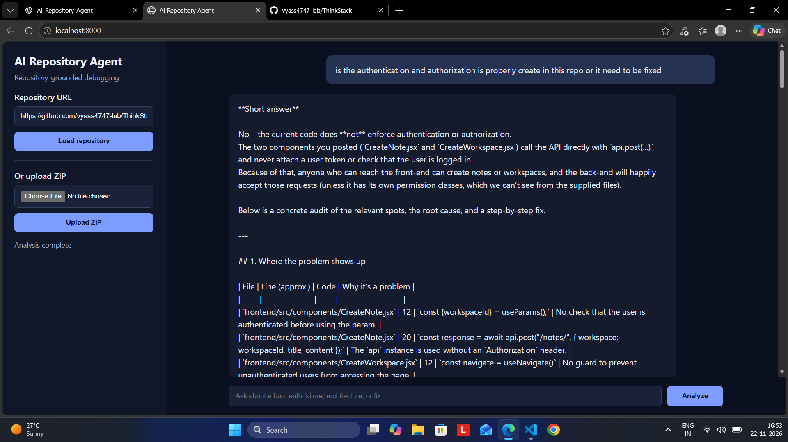

## AI Repository Agent

Run the agent from the repository root:

```powershell
uv run ai-repository-agent
```

For the web deployment:

```powershell
uv run uvicorn ai_repository_agent.app:app --host 0.0.0.0 --port 8000
```

Open `http://localhost:8000`.

Users can load a public GitHub, GitLab, or Bitbucket HTTPS repository URL,
or upload a ZIP repository archive, then ask repository-grounded questions.

Set a Groq API key in `.env`:

```text
GROQ_API_KEY=your_key_here
```

Ask a repository question such as:

```text
Why is authentication failing?
Where is the user login bug?
Explain the database connection error and suggest a fix.
```

The agent lists repository files, scores files relevant to the question, reads
the most relevant source files, and asks the model for a root-cause and fix.
It never reads `.env` or files outside the repository.